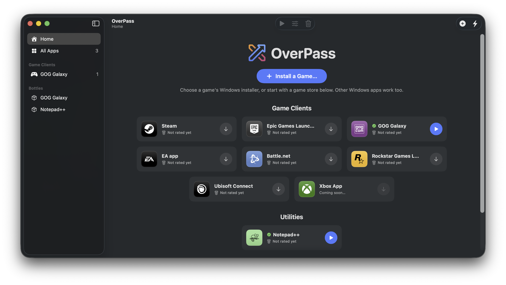
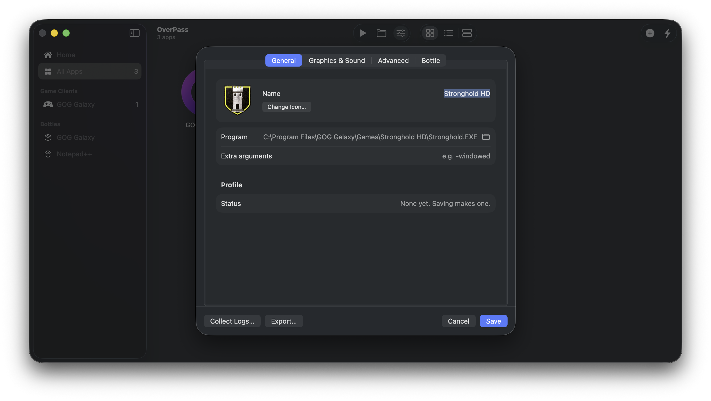

# OverPass

[](https://ko-fi.com/arctim)

Run Windows games on your Mac without managing Wine yourself. Pick a game or launcher, click Install, and OverPass downloads Wine, makes a container for it, installs the runtimes it needs and adds it to your library.

Version 0.3.0. Made by [Arctic Imaginarium](https://arctim.no). Landing page: [overpass.arctim.no](https://overpass.arctim.no).

OverPass is built on Wine, DXMT and many other open-source projects: see [CREDITS](CREDITS.md), and please support them too.

## Install

Paste this into Terminal:

```sh
curl -fsSL https://overpass.arctim.no/install | bash
```

It downloads the newest release, puts OverPass in your Applications folder and opens it.

Or download `overpass-<version>.zip` from [Releases](https://github.com/McKack/overpass/releases), unzip it and move OverPass to Applications. OverPass isn't notarized by Apple yet, so the first time macOS says it can't verify the app: open System Settings › Privacy & Security and click **Open Anyway**.

Needs macOS 15 or later on a Mac with Apple silicon. Updates install from inside OverPass.

## Features

**Install and play**
- One-click install of games, launchers and utilities such as Notepad++ and MusicBee.
- Open a `.exe` or `.msi` from Finder in OverPass to install it, or use Quick Launch to run a program once.
- Install once, then later containers start from a saved template in seconds.
- A Dock menu with running titles, recent titles, game clients and Stop All Windows Programs.

**Library**
- Home and library views as icons, list, rows or covers, with a status bar and sort menu.
- Cover art from the stores, with game-case and 3D-case styles, or your own cover and icon.
- Sidebar categories for each store, Favorites, your own categories, Mac apps and other titles.
- Uninstall from the library, the sidebar or the File menu.

**Containers**
- Each program group gets its own Windows environment, called a container.
- Per-container settings: Windows version, Retina mode, keyboard mapping, dark or light appearance, PlayStation controllers as Xbox pads, and drives.
- Export a container to a `.tar.gz` and import it again.
- Choose where containers are stored, including other disks, and move them between locations.
- Open Wine Settings, Registry Editor and Task Manager, and show logs, from the container page.

**Graphics**
- OverPass Runtime: Direct3D 10, 11 and 12 on Metal, built on DXMT, with DLSS translated to MetalFX, Shader Model 6.8, mesh shaders, tessellation and tiled resources.
- Direct3D 9 on Metal, or WineD3D.
- Max resolution setting for games, globally or per game.
- Shader compile options for Direct3D 12 games.
- Faster x87 math for old 32-bit games (opt-in, per game).
- Optional D3DMetal: if you have Apple's Game Porting Toolkit, OverPass can import it from your own copy. It is not needed and not redistributed.

**Profiles and compatibility**
- Per-game profiles: Windows version, runtimes, environment, DLL overrides and graphics. They are plain `.ini` files you can edit, import, export and share.
- Rules also reach programs a launcher starts, so a game started by Steam gets its own settings.
- A profile editor with Simple and Advanced views.
- Anti-cheat warnings, from Are We Anti-Cheat Yet data, before a game that uses one starts. They warn and never block.

**Stores**
- Steam, Epic Games, GOG, EA, Battle.net, Ubisoft and Rockstar install in one click.
- GOG library inside OverPass: sign in, see what you own, then install and launch without GOG Galaxy. Epic works the same way (Beta).
- Xbox (Beta, opt-in): off by default, enabled from Home after you accept the risks.

**Updates and reports**
- Daily update check for the app, OverPass Wine, OverPass Runtime and extras. Update All from Settings › Components.
- Report Issue: logs, your Mac's details and the game's settings, with your name scrubbed, sent to OverPass or opened as a GitHub issue. Also from an in-game hotkey, and offered after a crash.
- OverPass notices its own crash and offers to report it at the next start.

## Screenshots

Home lists featured games and launchers. Pick one and click Install:



The library holds everything you have installed, grouped by category:


The profile editor changes a program's Windows version, runtimes, environment, DLL overrides and graphics backend:



[More screenshots…](docs/SCREENSHOTS.md)

## How it works

- **Wine** is downloaded during first-run setup. It isn't bundled. OverPass uses [OverPass Wine](https://github.com/McKack/overpass-wine). Gcenx's upstream builds are the fallback.
- **Profiles** (`src/Sources/OverPass/Profiles/*.ini`) are open, per-app files: install recipe sections plus compatibility rules, documented in `src/Sources/OverPass/Profiles/README.md`. OverPass Wine reads the rules too.
- **Components** (OverPass Wine, OverPass Runtime, winetricks and others) are managed from Settings › Components.

## Open source

OverPass itself is under the [GPL-3.0](LICENSE). Bug reports, test results and game profiles are welcome: see [CONTRIBUTING](CONTRIBUTING.md).

[OverPass Wine](https://github.com/McKack/overpass-wine) and [OverPass Runtime](https://github.com/McKack/overpass-runtime) are free for anyone to use in their own projects and game ports. Neither needs Apple's Game Porting Toolkit or any closed part.

- OverPass Wine is upstream Wine plus CodeWeavers' LGPL changes plus OverPass's patches. Wine is LGPL.
- OverPass Runtime is DXMT's main branch with D3D12, NVAPI and NGX enabled, plus OverPass's additions. It is under the LGPL 2.1.

## Building

```sh
cd src
scripts/build-app.sh   # builds src/build/OverPass.app and installs it in /Applications
```

Requires macOS 15+ and Xcode command-line tools. Wine runs under Rosetta 2 on Apple silicon.

## Credits

OverPass builds on [Wine](https://www.winehq.org), [Gcenx's macOS Wine builds](https://github.com/Gcenx/macOS_Wine_builds), [DXMT](https://github.com/3Shain/dxmt), [Winetricks](https://github.com/Winetricks/winetricks) and [MoltenVK](https://github.com/KhronosGroup/MoltenVK). The install-and-play experience is inspired by CrossOver by CodeWeavers, one of Wine's largest contributors. OverPass Wine builds on CodeWeavers' LGPL-licensed Wine source; no proprietary CodeWeavers code or data is included. Thanks also to ProtonDB, Lutris, Bottles and Whisky.

## Trademarks

Steam is a trademark of Valve Corporation. Epic Games is a trademark of Epic Games, Inc. GOG.com and GOG Galaxy are trademarks of GOG sp. z o.o. EA is a trademark of Electronic Arts Inc. Battle.net is a trademark of Blizzard Entertainment, Inc. Rockstar Games is a trademark of Take-Two Interactive Software, Inc. Ubisoft is a trademark of Ubisoft Entertainment. Xbox is a trademark of Microsoft Corporation. Store logos (`src/Sources/OverPass/Logos/`) come unmodified from [Simple Icons](https://simpleicons.org) 16.34.0 (CC0) and, for Xbox, [Bootstrap Icons](https://icons.getbootstrap.com) (MIT) and are used only to identify each store; the GOG Galaxy mark is OverPass's own. OverPass is not affiliated with or endorsed by any of these companies.
