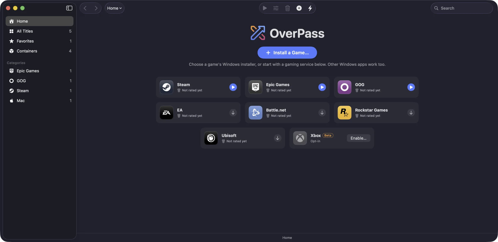
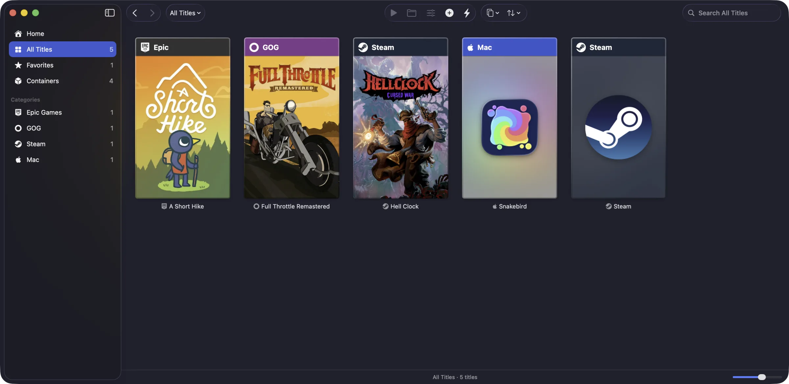
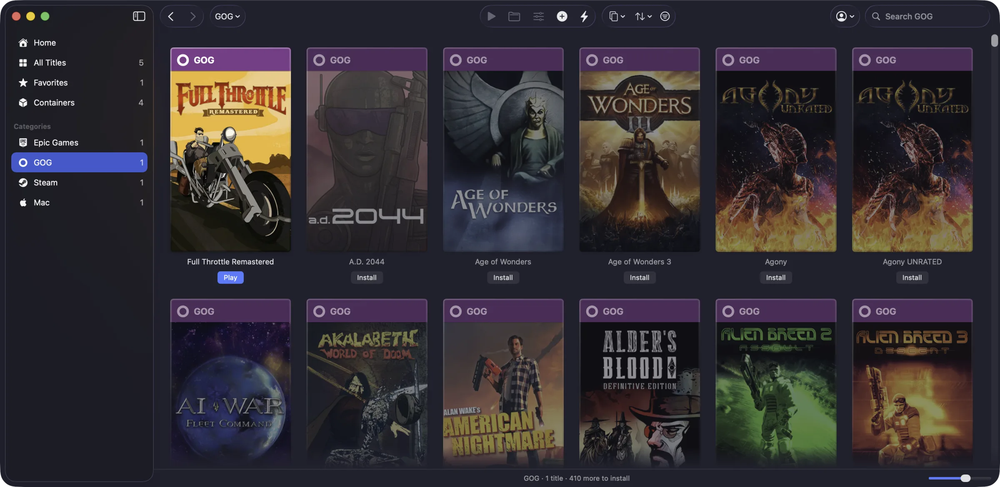

# OverPass

[](https://ko-fi.com/arctim)

Run Windows games on your Mac without managing Wine yourself. Pick a game or launcher, click Install, and OverPass sets up the rest.



## Install

Paste this into Terminal:

```sh
curl -fsSL https://overpass.arctim.no/install | bash
```

Or download `overpass-<version>.zip` from [Releases](https://github.com/McKack/overpass/releases), unzip it and move OverPass to Applications. OverPass isn't notarized by Apple yet, so the first time, open System Settings › Privacy & Security and click **Open Anyway**.

Needs macOS 15 or later on Apple silicon. Updates install from inside OverPass.

Something not working? See [Troubleshooting](docs/troubleshooting.md), or use Report Issue in OverPass.

## Screenshots

Everything you have installed, from every store:



Sign in to GOG or Epic Games and your whole library shows up:



[More screenshots…](docs/SCREENSHOTS.md)

## What it does

- **Install and play:** games, launchers and apps in one click, each in its own container.
- **Stores:** Steam, Epic Games, GOG, EA, Battle.net, Ubisoft and Rockstar. GOG and Epic Games libraries work without their launchers. Xbox is opt-in.
- **Library:** covers, categories, favorites and your Mac games in one place.
- **Graphics:** Direct3D 9 to 12 on Metal, 32-bit and 64-bit, with DLSS through MetalFX.
- **Profiles:** per-game settings in plain `.ini` files you can edit and share.
- **Updates and reports:** everything updates from inside OverPass, and Report Issue sends a problem in without a GitHub account.

## Open source

OverPass is [GPL-3.0](LICENSE), made by [Arctic Imaginarium](https://arctim.no). Bug reports, test results and game profiles are welcome: see [CONTRIBUTING](CONTRIBUTING.md). What's coming is in the [ROADMAP](ROADMAP.md), what changed in the [CHANGELOG](CHANGELOG.md).

It builds on [overpass-wine](https://github.com/McKack/overpass-wine), [overpass-runtime](https://github.com/McKack/overpass-runtime), Wine, DXMT and many other projects, which are free for anyone to use. See [CREDITS](CREDITS.md), which also lists trademarks, and please support those projects too.

To build it, with macOS 15 or later and the Xcode command-line tools:

```sh
cd src
scripts/build-app.sh
```
