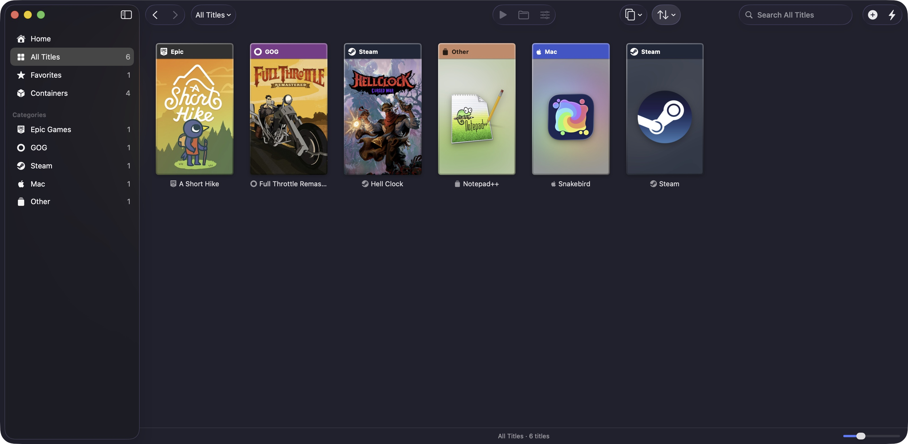
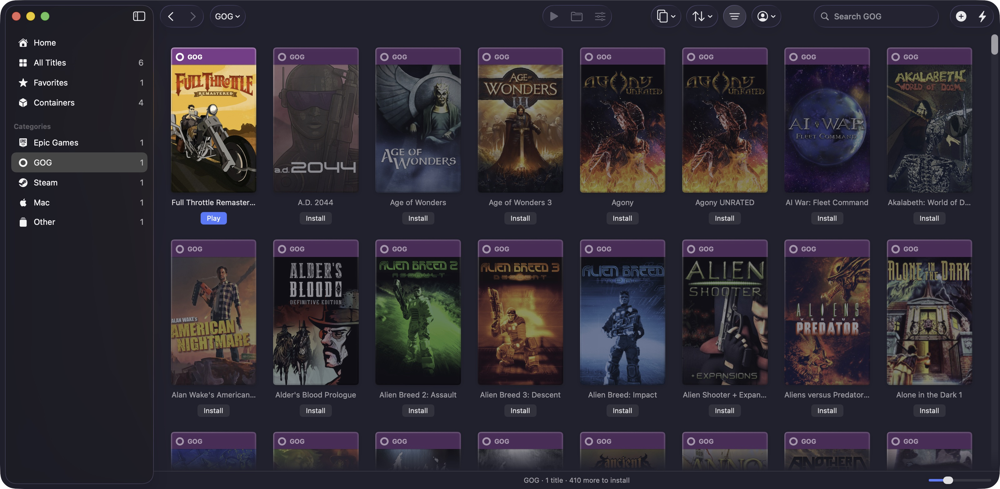
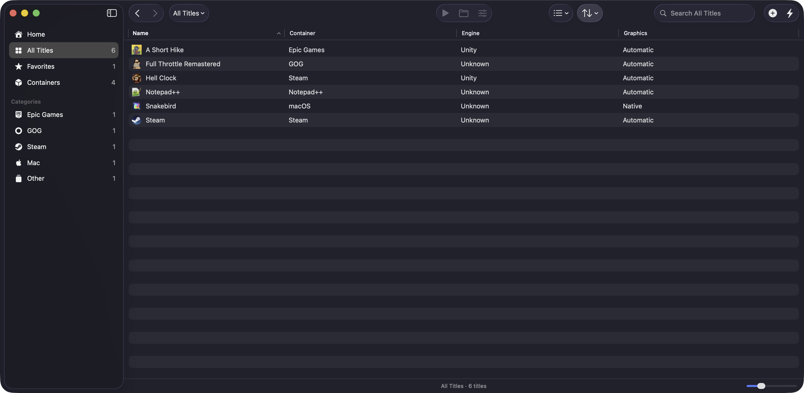

# Screenshots

OverPass in action. More will be added as OverPass grows.

Home lists the game stores and featured apps. Pick one and click Install, or Run once it's there:

Everything you have installed, from every store, as covers in cases named after where each game comes from:

Sign in to GOG or Epic Games and your whole library shows up. Install games straight from OverPass, no launcher needed:

The list view shows each title's container, the game engine OverPass found and its graphics backend:

Each game has its own settings: graphics backend per Direct3D version, faster x87 math, a resolution cap and more:

