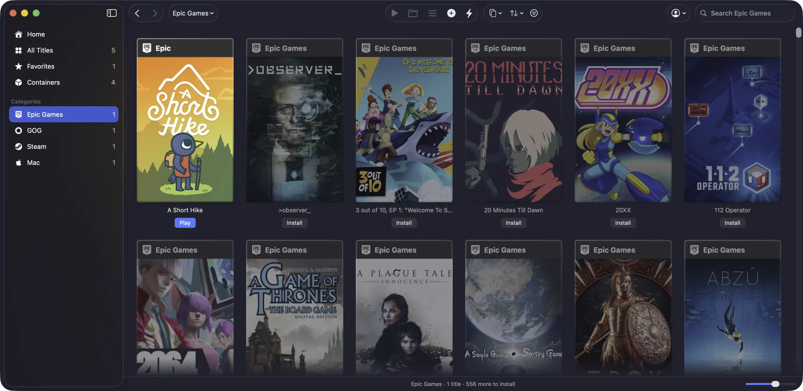
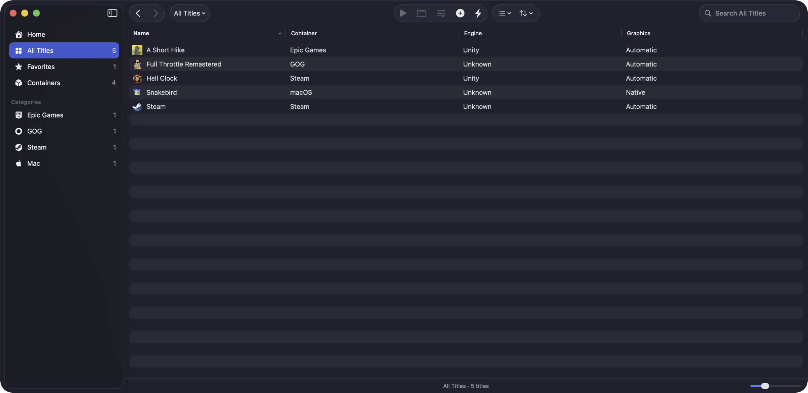
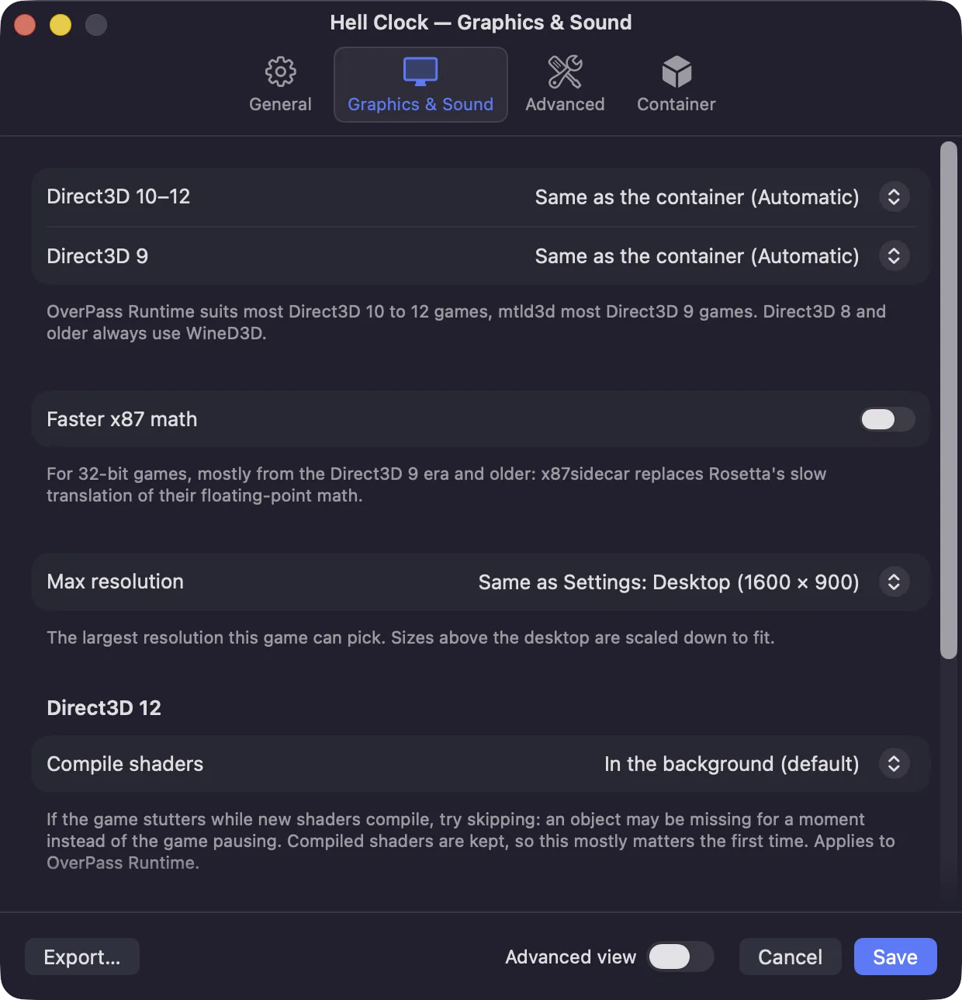
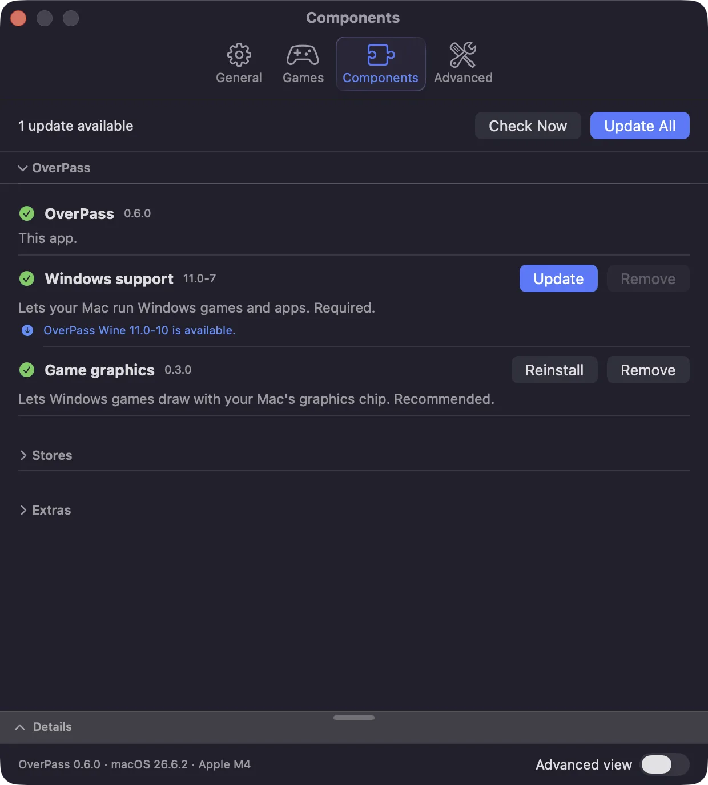

# Screenshots

OverPass 0.6.0. More will be added as OverPass grows.

Everything you have installed, from every store, as covers named after where each game comes from:

Home: start with a gaming service. Steam, Epic Games and GOG are a click away, and Epic and GOG need no launcher:

Sign in to GOG and your whole library shows up. Install games straight from OverPass:

The same for Epic Games, without the Epic Games Launcher:

The list view shows each title's container, the game engine OverPass found and its graphics:

Each game has its own settings: graphics per Direct3D version, faster x87 math, a resolution cap and more:

OverPass keeps Wine, the graphics runtime and the store clients up to date:

